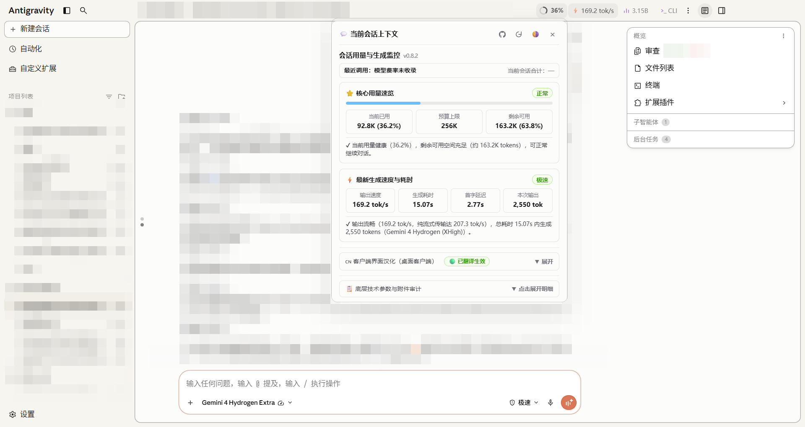
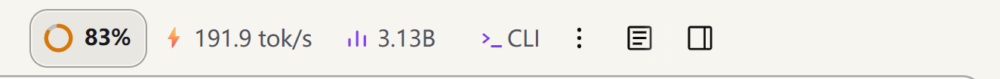
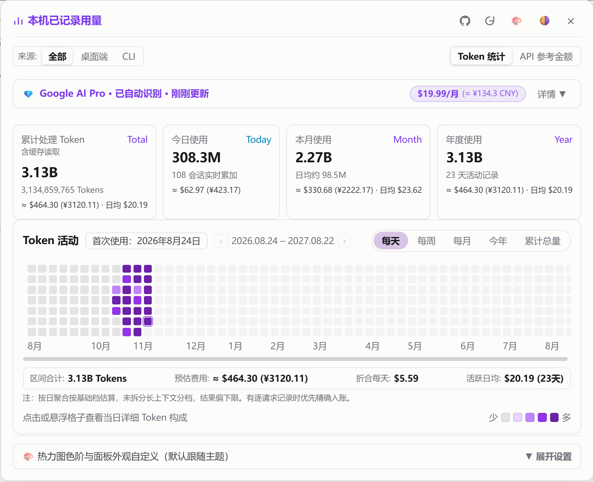

# Antigravity Chuanban Theme + ContextViewer Suite

[简体中文](README.md) · **English**

A **Claude-style UI beautification and localization plugin for Google Antigravity 2.x** (仿Claude风格的antigravity反重力美化插件, verified for `2.33.0+`). It integrates the **Chuanban theme patch `v5.5.0`** (M1+M2 `2.33.0` CDP opt-in relay, `cdpAutoRelaunch`, `Google Sans Flex` + `AgSarasaUI`, `1,860` i18n keys) with a **streamlined Antigravity ContextViewer `v0.8.8`** (Quota Ring, Speed tab, By-Model usage, session timeline, multi-account bridge, crisp DPI popup positioning, `v3.3.4` Chinese localization with merged Chuanban dictionary fallback) via pure Chrome DevTools Protocol (CDP) and loopback HTTP daemons without modifying official `app.asar`.

---

## Preview

**Full Claude-Style Workbench View (workspace names, session titles, diff counts, and chat transcript redacted):**



**Toolbar Capsules (Chuanban Theme + Context Meter + Speed + Token Total + CLI):**



| Streamlined Context Panel (`580px` max height; 256K, ProxyNoTun, and color drawer removed) | Token Usage Summary and 52-Week Heatmap |
| :---: | :---: |
|  |  |

---

## Upstream Projects and Adaptations

This repository combines and adapts two open-source community projects so they run side by side without UI conflicts or heavy main-thread stalls:

1. **[Anarcadia/chuanban-antigravity-theme-patch](https://github.com/Anarcadia/chuanban-antigravity-theme-patch)** (`v5.5.0`)
   - Reused components: Theme styling, `Google Sans Flex` × `AgSarasaUI` font setup, Antigravity `2.33.0+` single-icon M1+M2 CDP opt-in relay (patching `.lnk`/`.desktop` shortcuts with `--remote-debugging-port=0` and automatic cold-start `--updated` relaunch), live `plugin://swarm--` iframe theme relay, host fingerprint gate, WSL2 dual-track support, native ME-SDDL Scheduled Task autostart, optional warm dark preset, and `1,860`-key dictionary.
   - Suite adaptations ([`assets/theme-user-config.json`](assets/theme-user-config.json), [`assets/theme-user-custom.js`](assets/theme-user-custom.js)): Disables Chuanban's overlapping `i18n` and `metrics` modules (`false`), sets `"darkPreset": "onyx"` (switchable to `"claude-warm"`), and retains `composerWaxSeal`, `deadlockHealer`, `coldBootHealer`, `zoomShortcuts`, `cdpAutoRelaunch`, `customCss`, and `customJs`. When a ContextMeter, Quota, datepicker, or modal popup (`#panel`, `#panel-quota`, `#panel-tokens`, `#valid-end-popover`, `#account-remove-modal`, etc.) opens, `theme-user-custom.js` promotes `#ag-context-meter` and its stacking ancestors to `z-index: 2147483500`, invokes `wcvBrowser.setPortalOverlayOpen`, and watches host parent `childList` plus capture-phase clicks so re-injected meters rebind immediately.
2. **[elviscjn-cjn/antigravity-context-viewer](https://github.com/elviscjn-cjn/antigravity-context-viewer)** (pinned verified base commit `838211fea3d305c72f3fe5f0c6ec340a644d481a`, `v0.8.8`)
   - Reused components: Titlebar context meter, Model Quota Ring (`#badge-quota` + `/quota` panel), multi-account usage isolation, By-Model 7d/30d stacked chart and WSL usage aggregation, session request timeline, speed comparison & ELV-91 scoring, custom datepicker and trilingual currency rules, crisp external-display font & DPI pixel-grid positioning (`ELV-84`/`ELV-86`), brand/language toggles, and the `v3.3.4` desktop Chinese localization runtime (`chinese` module).
   - Suite adaptations ([`patches/context-viewer.patch`](patches/context-viewer.patch), [`assets/antigravity-patch-guardian.mjs`](assets/antigravity-patch-guardian.mjs)):
     - Replaces `app.asar` disk modification with CDP runtime injection backed by a dynamic multi-origin loopback HTTP bridge (`process.noAsar = true`), enforces Antigravity host fingerprint checks so local preview pages are never touched, adds uncaught exception/rejection crash logging, aligns live version and capability reporting with `v0.8.8` across `/quota`, `/scan`, `/session-timeline`, `/accounts-overview`, `/accounts-action`, `/modules-status`, `/toggle-module`, and `/open-external`, and restores a clean `app-*-base.asar` backup if an earlier ASAR marker is found.
     - Merges safe filtered entries from Chuanban `v5.5.0`'s `1,860`-key `core/i18n.json` as fallback behind ContextViewer `zh-CN.json` (plus injecting `window.__AGY_I18N_CONFIG__`) while keeping only one DOM observer active.
     - Removes binary-patching/bloat panels (`#tab-ctx-models`, `#pane-ctx-models`, `#ctx-compact-card`, enhance preset/prompt cards, `proxy-notun-drawer`, `btn-toggle-colors` / panel palette), suppresses startup update prompts (`autoCheckUpdate = false`), and caps `#panel` and `#panel-quota` height at `580px`.
     - Pairs upstream `6ms` `rAF` DOM translation slicing and `observedTitlebar` checks with large-history anti-stutter guards: staggers `requestPoll` (`450ms`) and `/scan` (`1500ms`) on every conversation entry (including cold-start first click), strips raw image base64 (`inlineData`) from `/scan` payloads, runs `/record-calls` via `recordModelCallsAsync`, coalesces `/token-history` behind a `60s` daemon TTL cache with `10s` delayed startup warmup and `60s` background polling, avoids duplicate `1.5 MB` CDP re-injections on SPA transitions, and skips regex scans in `translateSingleUnit` for strings longer than `500` characters.

---

## One-Sentence Prompt for AI Agents

Copy either prompt below to Antigravity or another AI coding agent on a target machine to clone and install the suite automatically:

**English prompt:**

> Clone `https://github.com/jyxu0621/antigravity-chuanban-context-suite` into `~/.gemini/config/skills/antigravity-chuanban-context-suite`, read `SKILL.md` and `README.en.md`, and run `node scripts/setup.mjs` followed by `node scripts/verify.mjs` to install and verify the Chuanban theme and streamlined ContextViewer suite in pure CDP mode without modifying `app.asar`.

**中文一句指令：**

> 请把 `https://github.com/jyxu0621/antigravity-chuanban-context-suite` 克隆到全局 Skills 目录（`~/.gemini/config/skills/antigravity-chuanban-context-suite`），阅读里面的 `SKILL.md` 和 `README.md`，运行 `node scripts/setup.mjs` 和 `node scripts/verify.mjs` 完成安装与校验（保持纯 CDP 模式，不要修改 `app.asar`）。

> [!IMPORTANT] **Execution Notes for AI Agents (see [`SKILL.md`](SKILL.md))**
> - Do not modify official `app.asar`. On Windows, `setup.mjs` registers and starts Scheduled Tasks `AntigravityThemeDaemon` and `AntigravityPatchGuardian` via `Register-ScheduledTask` so both daemons outlive short-lived agent Win32 Job Objects; on macOS and Linux, it writes a `LaunchAgent` and a `systemd --user` service.
> - Do not force-kill the running Antigravity host process from inside an active session. If CDP is not active yet after first setup, ask the user to quit and relaunch Antigravity once using the updated shortcut, then run `node scripts/verify.mjs`.
> - Chuanban fonts (Anthropic + Sarasa) are optional and distributed separately on [Google Drive](https://drive.google.com/drive/folders/1NX92SgVUqtSjWg6bt6sIJXy-cn7J_boC); pass `--fonts-from <font-folder>` during setup after downloading.

---

## Summary of Changes

- Separated module ownership: Chuanban `v5.5.0` handles theme styling, `Google Sans Flex` typography, Antigravity `2.33.0+` CDP opt-in relay, Swarm/PDF live rendering fixes, and cold-boot/deadlock recovery, while ContextViewer `v0.8.8` provides context metrics, Model Quota Ring, multi-account isolation, By-Model stats, session timeline, speed comparison, crisp DPI placement, `v3.3.4` localization (with merged `1,860`-key Chuanban dictionary fallback), and token history without overlapping observers.
- Fixed panel overlap: Elevated `#ag-context-meter` stacking context keeps `#panel`, `#panel-quota`, and token popovers above right-hand web or preview panes and restores original styles on close, with immediate rebinding on DOM remounts.
- Reduced viewport clutter: Unused experimental Models/256K, Enhance prompt/title, ProxyNoTun, color customizer, and update drawers stay removed, and both `#panel` and `#panel-quota` `max-height` stay capped at `580px`.
- Smoothed route transitions: Pairs upstream `6ms` rAF time-slicing and `observedTitlebar` fast checks with `450ms`/`1500ms` cold-start & route stagger, `/scan` base64 stripping, async worker call recording, `60s` coalesced `/token-history` caching, duplicate-injection prevention, and long-string regex bypassing to eliminate heavy stalls when opening existing conversations.
- Preserved across updates: `Page.addScriptToEvaluateOnNewDocument` and OS logon autostart re-apply the injected bundle automatically across window reloads, client restarts, and Antigravity updates.

---

## Quick Start

Prerequisites: **Node.js `>= 22.0.0`** and **Git**.

### Windows (PowerShell)

```powershell
git clone https://github.com/jyxu0621/antigravity-chuanban-context-suite.git "$env:USERPROFILE\.gemini\config\skills\antigravity-chuanban-context-suite"
cd "$env:USERPROFILE\.gemini\config\skills\antigravity-chuanban-context-suite"

# Preview resolved paths without modifying files
node scripts/setup.mjs --dry-run

# Run idempotent installation and verification (optionally add --fonts-from "C:\path\to\fonts")
node scripts/setup.mjs
```

### macOS / Linux

```bash
git clone https://github.com/jyxu0621/antigravity-chuanban-context-suite.git ~/.gemini/config/skills/antigravity-chuanban-context-suite
cd ~/.gemini/config/skills/antigravity-chuanban-context-suite

node scripts/setup.mjs --dry-run
node scripts/setup.mjs
```

### Optional Flags

| Flag | Purpose |
| --- | --- |
| `--context-viewer-dir <dir>` | Custom path for the `antigravity-context-viewer` clone |
| `--theme-repo-dir <dir>` | Custom path for `chuanban-antigravity-theme-patch` (default: `~/.gemini/antigravity/chuanban-theme-repo`) |
| `--fonts-from <dir>` | Path to downloaded Chuanban font folder passed to `install-fonts --from` |
| `--latest` | Apply the patch onto upstream `HEAD` instead of resetting to pinned commit `838211f` |
| `--skip-tests` | Skip `node --test` unit tests after patching `antigravity-context-viewer` |
| `--skip-verify` | Skip final `verify.mjs` execution |

---

## Verification and Rollback

```bash
# Full check (config files, clean official app.asar, running daemons, live CDP DOM/bridge/quota/z-index)
node scripts/verify.mjs

# Static and daemon check only (when Antigravity is closed)
node scripts/verify.mjs --skip-cdp
```

Run upstream ContextViewer core unit tests directly inside the patched viewer folder (225 tests passing):

```bash
node --test meter-core.test.js meter-renderer.test.js meter-integration.test.js meter-v083-fixes.test.js meter-hotload.test.js meter-elv91-speed.test.js meter-v089-usage.test.js
```

> Overwritten user files are backed up under `<STATE_DIR>/backups/skill-setup/`. Stopping the two CDP daemons and uninstalling Chuanban restores stock Antigravity UI on reload or restart without modifying `app.asar`.

---

## Repository Layout

```text
antigravity-chuanban-context-suite/
├── .gitattributes                       # Keeps .patch byte-exact with LF line endings
├── .gitignore
├── SKILL.md                             # Antigravity skill definition and workflow
├── README.md                            # Chinese documentation
├── README.en.md                         # English documentation (this file)
├── assets/
│   ├── antigravity-patch-guardian.mjs   # Portable CDP + loopback HTTP bridge daemon
│   ├── preview-workbench-full.png       # Preview: full Claude-style workbench (redacted)
│   ├── preview-titlebar.png             # Preview: titlebar capsules and Chuanban theme
│   ├── preview-context-panel.png        # Preview: streamlined conversation context popover
│   ├── preview-tokens-panel.png         # Preview: token summary and heatmap popover
│   ├── theme-user-config.json           # Adapted Chuanban user/config.json
│   └── theme-user-custom.js             # Adapted Chuanban user/custom.js (stacking & WebContentsView sync)
├── patches/
│   └── context-viewer.patch             # Clean patch over upstream@838211f (v0.8.8)
└── scripts/
    ├── setup.mjs                        # Cross-platform idempotent installer
    └── verify.mjs                       # Static, daemon, and live CDP verification script
```
