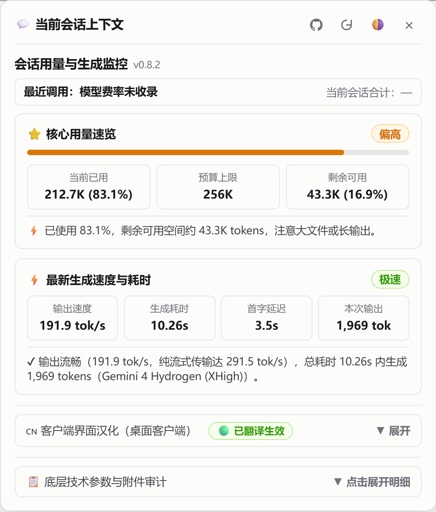

# Antigravity Chuanban Theme + Ultra-Slim ContextViewer Suite

[简体中文](README.md) · **English**

A **Claude-style UI beautification and localization plugin for Google Antigravity 2.x** (仿Claude风格的antigravity反重力美化插件, verified on **`2.36.0+`**). It integrates the **Chuanban theme patch `v6.0.7`** (single `2,371`-key localization engine excluding Diff `.code-line`, Follow System light/dark pairing, native Claude compact context menu, eliminated `body:has()` recalc `40ms -> 2.2ms`, isolated `#ag-font-faces`, `2300x` 5-slot theme & `[EN | 中文]` switcher, R2/GitHub mirror `--auto-download` fonts with Windows UTF-16 registry hardening, DSH-style bottom live metrics capsule, native Settings Token Analytics & hot-upgrade row, high-refresh-rate GPU animation-offload CSS, plus HTTP 206 Omni Streaming File Viewer & bare-link enhancer) with an **ultra-slim, zero-lag Antigravity ContextViewer `v0.8.10`** (titlebar Context Ring + Speed capsule with pure SVG hourglass only) via pure Chrome DevTools Protocol (CDP) and self-healing loopback HTTP daemons — **without modifying official `app.asar`**.

---

## Measured Performance Benchmarks (Antigravity `2.34.0`, 14/14 Closed-Loop Suite)

| Metric | Before | After (Measured Live) | Reduction / Result |
| --- | --- | --- | --- |
| Active GPU animations (6s window) | `131` | **`0`** | **-100%** |
| `RecalcStyle` time (6s window) | `221–371 ms` | **`14 ms`** | **-94% to -96%** |
| `AG-GPU` process CPU usage | `32.6%` | **`2.3%`** | **-92.9%** |
| `PatchGuardian` resident memory (RSS) | `860 MB` (+233 MB cold-start spike) | **`20–31 MB`** (`20 MB` RSS after ~3h uptime) | **-96% to -97%** |
| `PatchGuardian` background CPU usage | `51.6%` | **`0.0–0.6%`** | **-99%** |
| High-refresh frame pacing | Occasional hitches on scroll/switch | **`125 FPS`** (`max=10.1 ms`, `jank33=0`), closed-panel JS hotspots `0/4,982` | **Zero jank** |

---

## Preview

> Note: Screenshots below show the overall Claude-style workbench and context popover aesthetic. In the current `v5.5.3 + v0.8.9` ultra-slim release, the titlebar is streamlined to just Context Ring + Speed capsule, cumulative token analytics live in Chuanban's native **Settings → Token Analytics**, and the bottom composer displays a DSH-style metrics capsule (`入 <used>/<limit> (<pct>%) · 出 <out> · <tps> tok/s · 首字 <ttft>`).

**Full Claude-Style Workbench View (workspace names, session titles, diff counts, and chat transcript redacted):**


| Streamlined Context Panel (`580px` max height; Models/256K/Enhance/ProxyNoTun/color drawer removed) | Toolbar Visual Reference |
| :---: | :---: |
|  |  |

---

## Upstream Projects and Adaptations

This repository combines and optimizes two open-source community projects with clear ownership boundaries so they run smoothly without dual observers or background resource storms:

1. **[Anarcadia/chuanban-antigravity-theme-patch](https://github.com/Anarcadia/chuanban-antigravity-theme-patch)** (`v6.0.7`)
   - Ownership & reused components: 5-slot light/dark theme styling (`morandi` default, `absolutely` Claude warm-paper, `native`, `claude-warm`, `onyx`) with Follow System pairing, `2300x` `style.disabled` switching and `[EN | 中文]` toggle, native Claude compact right-click menu (`contextMenu: true`), eliminated `body:has()` full-tree recalc (`40ms -> 2.2ms`), permanent `#ag-font-faces` isolation, built-in R2/GitHub mirror proxy-aware `install-fonts --auto-download --retire-super-ttc` and Windows UTF-16 font registry writes, **sole `2,371`-key desktop localization engine** (`i18n: true`, excluding Diff `.code-line` with `[data-ag-plugin-ui]` shield), dual-mirror hot upgrade (`updateCheck: true`), WSL2 deadlock fix, self-healing bottom live metrics pill (`metrics: true`, `metricsMode: "full"`), native Settings **Token Analytics** (`tokenAnalytics: true`), Antigravity `2.33–2.36+` M1+M2 CDP opt-in relay with `cdpAutoRelaunch`, live `plugin://swarm--` iframe theme relay, host fingerprint gate, and native Windows ME-SDDL `TimeTrigger` autostart.
   - Suite adaptations ([`assets/theme-user-config.json`](assets/theme-user-config.json), [`assets/theme-user-custom.js`](assets/theme-user-custom.js), [`assets/theme-user-custom.css`](assets/theme-user-custom.css)):
     - **DSH Harness-style bottom capsule**: Event-driven wrapper around `window.__ag_render_metrics` (zero extra polling timers, leak-free `ctx.onCleanup`) formatting `#ag-live-metrics-pill` as `入 <used>/<limit> (<pct>%) · 出 <out> · <tps> tok/s · 首字 <ttft>` in `metricsMode: "full"` while preserving the native hover details card and passing through `v6.0.0+` `compact` ring mode cleanly.
     - **High-refresh-rate GPU offload CSS (`theme-user-custom.css`)**: Stops 12× `[data-agent-state-dot]` / `agentStateDot` 144Hz idle pulsing, `.shimmer-text-mask/.shimmer-text-content` GPU mask redraws, per-word streaming `span[style*="fade-in"]` WAAPI objects, decorative `.animate-pulse/.animate-ping/.animate-bounce`, and large-area `[class*="backdrop-blur"]` passes while preserving hover/click feedback.
     - **High-priority popup stacking & WebContentsView avoidance**: Promotes `#ag-context-meter` and stacking ancestors to `z-index: 2147483500` when `#panel` opens, calls `wcvBrowser.setPortalOverlayOpen(true)` (restoring cleanly on close), watches parent `childList` + capture-phase clicks, and relaxes fallback reconnect interval to `15s`.
     - **Workbench helpers + Bare-link highlights + Omni Streaming File Viewer (zero `innerHTML`, zero polling, seamless with Chuanban `v6.0.7` context menu)**:
       - `Alt+↑`/`Alt+↓` user-turn jump (non-editable focus only) and manual fold/unfold bars for completed `>= 48`-line code blocks (deferred while streaming);
       - Native `CSS.highlights` zero-DOM highlighting for bare URLs & local file paths (`Ctrl/Cmd+Click` opens bare URL or launches the Omni viewer);
       - Seamless bottom extension inside Chuanban `v6.0.7`'s native `#ag-custom-context-menu` (zero event interception): adds `⚡ Omni 流式预览` & `@reference` for files/bare paths, open/copy for bare URLs, and compact slash-command chips (`/compact`, `/plan`, `/grill-me`, `/learn`, `/goal`) + turn jump in conversation area;
       - **Omni Streaming File Viewer**: powered by `PatchGuardian`'s existing `127.0.0.1` loopback bridge (`/omni-stat` + 10-min per-file HMAC-signed HTTP `206 Range` `/omni-stream`, fail-closed against UNC/device paths and sensitive credentials like `.ssh`/`.env`/`Cookies`/`state.vscdb`), supporting large video/audio, zoomable checkerboard images/SVG, PDF, sandboxed HTML, range-sliced filterable CSV/TSV/JSONL tables, FontFace samples, and 256 KB chunked text/logs with zero extra daemon.

2. **[elviscjn-cjn/antigravity-context-viewer](https://github.com/elviscjn-cjn/antigravity-context-viewer)** (pinned verified base commit `ab5a41b7d515643fbbdd9dde8dc940e520a131b0`, `v0.8.10` — adds Antigravity `2.34.0` CSRF auth/window loader fixes while intentionally skipping the heavyweight `v0.9.x` dashboard rewrite)
   - Streamlining & optimizations ([`patches/context-viewer.patch`](patches/context-viewer.patch)):
     - Titlebar retains ONLY **`#badge`** (context ring + `%`) and **`#badge-speed`** (`⚡ tok/s` + ELV-93 pure SVG waiting hourglass); `#panel` retains Context, Speed Comparison (ELV-91), Session Overview, and Settings capped at `580px` with `content-visibility: hidden` when closed.
     - Removes `#badge-quota` / `#panel-quota`, `#badge-cli` / `#cli-launch-toast`, `#badge-tokens` / `#panel-tokens` (superseded by Chuanban `v5.5.3` Token Analytics), `#tab-ctx-models` / `#pane-ctx-models`, enhance cards, client brand/lang card, UI slim prefs card, `proxy-notun-drawer`, color drawers, and startup update prompts (`autoCheckUpdate = false`); fixes upstream `v0.8.9` extra `</div></div>` nesting inside `#pane-ctx-settings`; disables ContextViewer's duplicate `chinese` module with three-layer protection (`modules.chinese.enabled = false` + `language = "en"` verified via `loadModulesConfig()`, plus `PatchGuardian` automatically suppressing `i18n-runtime.js` whenever Chuanban `i18n: true` is active).
     - **Deep renderer anti-lag engineering**: Closed-panel O(1) fast-path in `render()`, `syncSpeedBadgeText()`, and `updateWaitOnly()` (flushed via `panelRenderDirty` on panel open); 16-item tail-window + memoization in `resolveLatestSessionCallRecord()`; O(1) streaming check & unchanged-visual-sig skip in `requestPoll()` (`1.5s` streaming / `5s` closed idle / `3s` open idle / `20s` hidden); `2s` hidden-tab `tick()` throttle; `hostDomObserver` stripped of `characterData`/`attributes` with `250ms` throttle + titlebar fast-path; hard-stops `/quota`, `/accounts-overview`, `/record-calls`, and background `/token-history` polling (including gating startup `syncTokenHistoryFromHost()` in `heatmap.js`); strict on-demand `/scan` only when the technical audit drawer opens or on manual refresh; preserves elevated `z-index` in `ensureHostDocked()` and routes `openGithubRepo` via `/open-external`.

3. **Ultra-Light Pure CDP + Dynamic Loopback Bridge Daemon** ([`assets/antigravity-patch-guardian.mjs`](assets/antigravity-patch-guardian.mjs))
   - Keeps official `app.asar` untouched (`process.noAsar = true`), restoring a clean `app-*-base.asar` backup if an older ASAR marker is present.
   - `5s` tick / `30s` lightweight heartbeat (page reloads handled instantaneously via CDP WebSocket events), dirty-checked `.live-session.json` writes, short-circuited `/record-calls` in slim mode (eliminating `35 MB` `pricing_ledger_v1.json` rewrite storms), slim capability reporting (`quota: false`, `recordCalls: false`, `launchCli: false`, `accounts: false`), and token-authenticated loopback `GET /health` exposing `rssMB` and `routeHits`.

---

## One-Sentence Prompt for AI Agents

Copy either prompt below to Antigravity or another AI coding agent on a target machine to clone and install the suite automatically:

**English prompt:**

> Clone `https://github.com/jyxu0621/antigravity-chuanban-context-suite` into `~/.gemini/config/skills/antigravity-chuanban-context-suite`, read `SKILL.md` and `README.en.md`, and run `node scripts/setup.mjs` followed by `node scripts/verify.mjs` to install and verify the Chuanban v5.5.3 + ultra-slim ContextViewer v0.8.9 suite in pure CDP mode without modifying `app.asar`.

**中文一句指令：**

> 请把 `https://github.com/jyxu0621/antigravity-chuanban-context-suite` 克隆到全局 Skills 目录（`~/.gemini/config/skills/antigravity-chuanban-context-suite`），阅读里面的 `SKILL.md` 和 `README.md`，运行 `node scripts/setup.mjs` 和 `node scripts/verify.mjs` 完成安装与校验（保持纯 CDP 模式，不要修改 `app.asar`）。

> [!IMPORTANT] **Execution Notes for AI Agents (see [`SKILL.md`](SKILL.md))**
> - Do not modify official `app.asar`. On Windows, `setup.mjs` preserves Chuanban's native ME-SDDL `AntigravityThemeDaemon` task and registers `AntigravityPatchGuardian` via `schtasks /Create /XML` (`S:(ML;;NW;;;ME)`, `Parallel`, `StopOnIdleEnd=false`, `LogonTrigger` + `PT1M` repeating `--ensure` watchdog) so both daemons outlive agent Win32 Job Objects and self-heal within 1 minute; on macOS and Linux, it writes a `LaunchAgent` (`KeepAlive`) and a `systemd --user` service (`Restart=always`).
> - Do not force-kill the running Antigravity host process from inside an active session. If CDP is not active yet after first setup, ask the user to quit and relaunch Antigravity once using the updated shortcut, then run `node scripts/verify.mjs`.
> - Chuanban fonts (Anthropic + Sarasa) are optional and distributed separately on [Google Drive](https://drive.google.com/drive/folders/1NX92SgVUqtSjWg6bt6sIJXy-cn7J_boC); pass `--fonts-from <font-folder>` during setup. On Windows, prefer the split `Windows-Sarasa-Split-SC-TTF` package with `node install.mjs install-fonts --from <split-ttf-dir> --retire-super-ttc` to retire `Sarasa-SuperTTC.ttc`.

---

## Quick Start

Prerequisites: **Node.js `>= 22.0.0`** and **Git**.

### Windows (PowerShell)

```powershell
git clone https://github.com/jyxu0621/antigravity-chuanban-context-suite.git "$env:USERPROFILE\.gemini\config\skills\antigravity-chuanban-context-suite"
cd "$env:USERPROFILE\.gemini\config\skills\antigravity-chuanban-context-suite"

# Preview resolved paths without modifying files
node scripts/setup.mjs --dry-run

# Run idempotent installation and verification (optionally add --fonts-from "C:\path\to\fonts")
node scripts/setup.mjs
```

### macOS / Linux

```bash
git clone https://github.com/jyxu0621/antigravity-chuanban-context-suite.git ~/.gemini/config/skills/antigravity-chuanban-context-suite
cd ~/.gemini/config/skills/antigravity-chuanban-context-suite

node scripts/setup.mjs --dry-run
node scripts/setup.mjs
```

### Optional Flags

| Flag | Purpose |
| --- | --- |
| `--context-viewer-dir <dir>` | Custom path for the `antigravity-context-viewer` clone |
| `--theme-repo-dir <dir>` | Custom path for `chuanban-antigravity-theme-patch` (default: `~/.gemini/antigravity/chuanban-theme-repo`) |
| `--fonts-from <dir>` | Path to downloaded Chuanban font folder passed to `install-fonts --from` (auto-adds `--retire-super-ttc` on Windows when split `SarasaUiSC-*.ttf` files are present) |
| `--retire-super-ttc` | Explicitly pass `--retire-super-ttc` to Chuanban `install-fonts` on Windows |
| `--skip-super-ttc-fix` | Skip automatic download/install of `Windows-Sarasa-Split-SC-TTF` when `Sarasa-SuperTTC.ttc` is active on Windows |
| `--go-mem-limit <preset\|off>` | Optionally configure/remove user-level `GOMEMLIMIT` (`1536MiB`/`2GiB`/`2500MiB`/`3GiB`/`4GiB`/`off`) to softly cap Go `language_server` memory |
| `--latest` | Apply the patch onto upstream `HEAD` instead of resetting to pinned commit `ab5a41b` (`v0.8.10`) |
| `--skip-tests` | Skip `node --test` unit tests after patching `antigravity-context-viewer` |
| `--skip-verify` | Skip final `verify.mjs` execution |

---

## Verification and Rollback

```bash
# Full check (config files, clean official app.asar, running daemons, /health RSS & routeHits audit, live CDP DOM/z-index/GPU CSS/DSH pill)
node scripts/verify.mjs

# Static, daemon, and /health check only (when Antigravity is closed)
node scripts/verify.mjs --skip-cdp
```

Run ContextViewer core unit tests directly inside the patched viewer folder (**245 tests passing**):

```bash
node --test meter-core.test.js meter-renderer.test.js meter-integration.test.js meter-v083-fixes.test.js meter-hotload.test.js meter-elv91-speed.test.js meter-v089-usage.test.js meter-v234-compat.test.js
```

> Overwritten user files are backed up under `<STATE_DIR>/backups/skill-setup/`. Stopping the two CDP daemons and uninstalling Chuanban restores stock Antigravity UI on reload or restart without modifying `app.asar`.

---

## Repository Layout

```text
antigravity-chuanban-context-suite/
├── .gitattributes                       # Keeps .patch byte-exact with LF line endings
├── .gitignore
├── SKILL.md                             # Antigravity skill definition and workflow
├── README.md                            # Chinese documentation
├── README.en.md                         # English documentation (this file)
├── assets/
│   ├── antigravity-patch-guardian.mjs   # Ultra-light pure CDP + loopback HTTP bridge daemon
│   ├── preview-workbench-full.png       # Preview: full Claude-style workbench (redacted)
│   ├── preview-titlebar.png             # Preview: historical titlebar reference
│   ├── preview-context-panel.png        # Preview: streamlined conversation context popover
│   ├── preview-tokens-panel.png         # Preview: historical tokens panel reference
│   ├── theme-user-config.json           # Adapted Chuanban v5.5.3 user/config.json
│   ├── theme-user-custom.css            # High-refresh GPU animation-offload user/custom.css
│   └── theme-user-custom.js             # DSH bottom capsule formatter + z-index & WebContentsView sync
├── patches/
│   └── context-viewer.patch             # Clean slim & zero-lag patch over upstream@1ec6f3d (v0.8.9)
└── scripts/
    ├── setup.mjs                        # Cross-platform idempotent installer
    ├── verify.mjs                       # Static, daemon, /health, and live CDP verification script
    ├── go-mem-limit.mjs                 # Optional user-level GOMEMLIMIT soft cap helper (--status/--set/--unset)
    └── storage-maintenance.mjs          # Read-only storage audit & move-only lossless archiver (--status/--archive/--restore)
```
