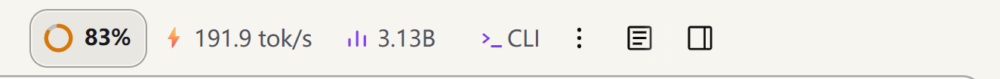
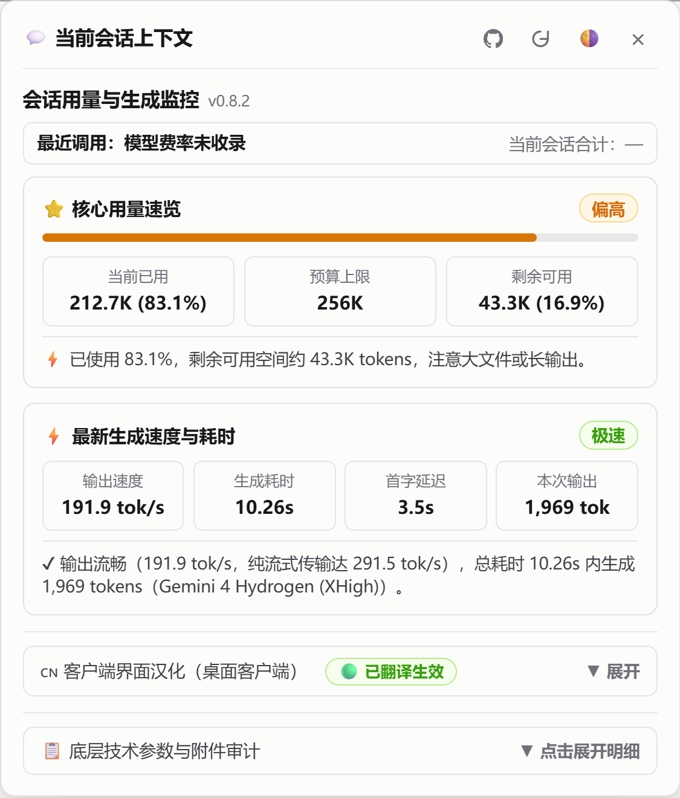
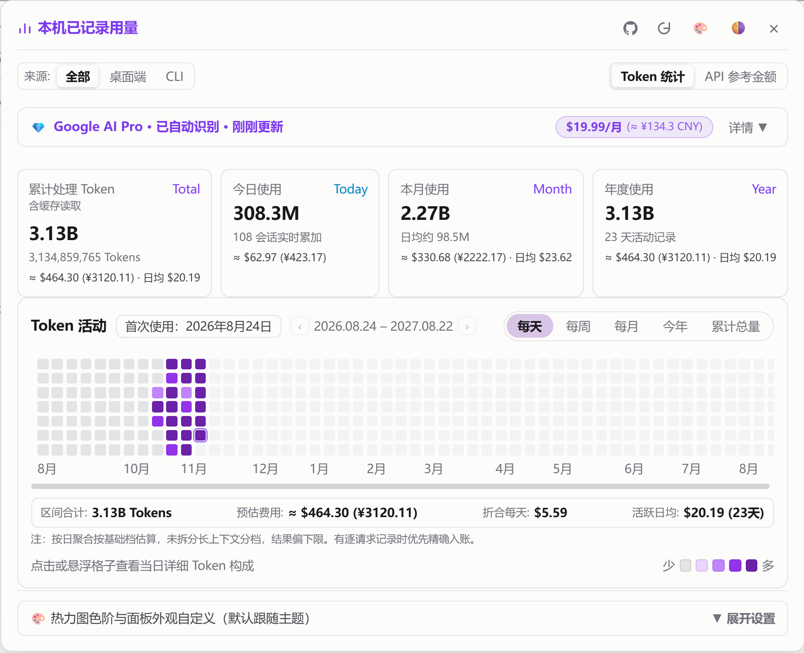

# Antigravity 船板主题 + 上下文监控与汉化融合套件

**简体中文** · [English](README.en.md)

在 Google Antigravity 2.x 中整合 **船板主题美化** 与 **精简版对话上下文监控 + v3.3.4 桌面端汉化**，通过 CDP 与本地回环 HTTP 守护进程注入，不改动官方 `app.asar`，重启、重载窗口或客户端更新后自动重新生效。

---

## 预览 (Preview)

**顶栏胶囊（船板主题 + 上下文进度 / 输出速度 / Token 累计 / CLI 入口）：**



| 精简版当前会话上下文面板（高度上限 `580px`，已移除 256K / ProxyNoTun / 配色抽屉） | 本机 Token 用量与 52 周热力图面板 |
| :---: | :---: |
|  |  |

---

## 上游项目与借鉴说明 (Upstream Projects)

本仓库整合并适配了社区中的两个开源项目：

1. **[Anarcadia/chuanban-antigravity-theme-patch](https://github.com/Anarcadia/chuanban-antigravity-theme-patch)**（船板主题补丁）
   - 借鉴与复用：沿用其主题样式、字体系统、调试端口启动配置以及 CDP 常驻守护思路。
   - 本仓库适配（[`assets/theme-user-config.json`](assets/theme-user-config.json)、[`assets/theme-user-custom.js`](assets/theme-user-custom.js)）：关闭与 ContextViewer 重复的内置 `i18n` 和 `metrics`，保留 `composerWaxSeal`、`deadlockHealer`、`customCss` 与 `customJs`；弹窗展开时将 `#ag-context-meter` 及其层叠上下文祖先提升至 `z-index: 2147483500`（关闭后还原，并配合 `wcvBrowser.setPortalOverlayOpen`），避免面板被右侧网页或预览窗格遮挡。
2. **[elviscjn-cjn/antigravity-context-viewer](https://github.com/elviscjn-cjn/antigravity-context-viewer)**（锁定已验证基线提交 `a204823f597e1aee482f35574798ecbec61874c9`）
   - 借鉴与复用：复用顶栏上下文用量显示、输出速度统计、Token 历史明细看板与 `v3.3.4` 中文汉化引擎。
   - 本仓库精简与调整（[`patches/context-viewer.patch`](patches/context-viewer.patch)、[`assets/antigravity-patch-guardian.mjs`](assets/antigravity-patch-guardian.mjs)）：
     - 将运行方式从修改 `app.asar` 改为纯 CDP 注入配合动态回环 HTTP 桥接守护（`process.noAsar = true`），若检测到旧版 ASAR 补丁标记，会尝试从干净 `*-base.asar` 备份恢复官方文件。
     - 移除 `256K 实验性解锁`、`ProxyNoTun 代理直连`、`指标配色自定义抽屉` 及面板内更新检查弹窗，并将主面板最大高度限制在 `580px`。
     - 加入防卡顿优化：`hostDomObserver` 通过 `observedTitlebar` 快速判定跳过无关 DOM 变动；切会话路由时将 `/scan` 错峰 `900ms` 发起，并在 `5s` 内对 `/token-history` 去重；汉化引擎 `flushPendingNodes` 采用 `8ms` `requestAnimationFrame` 分片，`translateSingleUnit` 在查完 `exactDict` 后跳过超过 `500` 字符文本的正则扫描。

---

## 一句话发给 Agent (One-Sentence Prompt for AI Agents)

在新电脑上把下面任意一句话发给 Antigravity 或其他 AI Agent，即可直接拉取并部署本套件：

**中文指令：**

> 请把 `https://github.com/jyxu0621/antigravity-chuanban-context-suite` 克隆到全局 Skills 目录（`~/.gemini/config/skills/antigravity-chuanban-context-suite`），阅读里面的 `SKILL.md` 和 `README.md`，运行 `node scripts/setup.mjs` 和 `node scripts/verify.mjs` 完成船板主题与精简防卡顿版 ContextViewer + v3.3.4 汉化的部署和验证（保持纯 CDP 模式，不要修改 `app.asar`）。

**English prompt:**

> Clone `https://github.com/jyxu0621/antigravity-chuanban-context-suite` into `~/.gemini/config/skills/antigravity-chuanban-context-suite`, read `SKILL.md` and `README.en.md`, and run `node scripts/setup.mjs` followed by `node scripts/verify.mjs` to install and verify the suite in pure CDP mode without modifying `app.asar`.

> [!IMPORTANT] **Agent 执行注意（详情见 [`SKILL.md`](SKILL.md)）**
> - 不要修改官方 `app.asar`。Windows 下 `setup.mjs` 会通过 `Register-ScheduledTask` 注册用户级登录自启任务 `AntigravityPatchGuardian`，使守护进程脱离 Agent 终端的 Win32 Job Object；macOS 和 Linux 分别注册 LaunchAgent 与 `systemd --user`。
> - 切勿在 Antigravity 会话内强杀宿主机进程。如果安装前客户端未启用远程调试端口，请在 `setup.mjs` 跑完后提示用户彻底退出并用更新后的快捷方式重开一次 Antigravity，再运行 `node scripts/verify.mjs`。
> - 船板字体（Anthropic + Sarasa）需从 [Google Drive](https://drive.google.com/drive/folders/1NX92SgVUqtSjWg6bt6sIJXy-cn7J_boC) 另行下载，并在安装时通过 `--fonts-from <字体目录>` 传入。

---

## 功能与精简明细 (Features & Customizations)

- 主题与监控职责隔离：船板负责主题配色、字体与原生界面修复，ContextViewer 负责上下文监控、`v3.3.4` 汉化与 Token 统计，关闭重叠模块避免互相覆盖。
- 弹窗置顶防遮挡：打开右上角监控面板或悬浮框时自动抬高宿主与祖先节点 `z-index` 至 `2147483500`，关闭后还原，不被右侧浏览器或预览窗格挡住。
- 精简面板高度：去掉 256K、ProxyNoTun、调色板抽屉与更新弹窗，主浮层固定 `max-height: 580px`，适配小屏与笔记本视口。
- 对话切换减抖动：通过路由错峰扫描、请求去重、rAF 8ms 分片与长文本跳过正则扫描，减少切对话瞬间的掉帧。
- 重启与升级自动重挂：依赖 `Page.addScriptToEvaluateOnNewDocument`、页面加载监听与系统级开机自启守护，客户端重启或版本更新后无需重新配置。

---

## 快速开始 (Quick Start)

前置条件：**Node.js `>= 22.0.0`**、**Git**。

### Windows (PowerShell)

```powershell
git clone https://github.com/jyxu0621/antigravity-chuanban-context-suite.git "$env:USERPROFILE\.gemini\config\skills\antigravity-chuanban-context-suite"
cd "$env:USERPROFILE\.gemini\config\skills\antigravity-chuanban-context-suite"

# 预览默认路径解析（不改动任何文件）
node scripts/setup.mjs --dry-run

# 一键安装并检查实时状态（如需安装字体可附加 --fonts-from "C:\path\to\fonts"）
node scripts/setup.mjs
```

### macOS / Linux

```bash
git clone https://github.com/jyxu0621/antigravity-chuanban-context-suite.git ~/.gemini/config/skills/antigravity-chuanban-context-suite
cd ~/.gemini/config/skills/antigravity-chuanban-context-suite

node scripts/setup.mjs --dry-run
node scripts/setup.mjs
```

### 可选参数

| 参数 | 说明 |
| --- | --- |
| `--context-viewer-dir <目录>` | 自定义 `antigravity-context-viewer` 克隆路径 |
| `--theme-repo-dir <目录>` | 自定义 `chuanban-antigravity-theme-patch` 克隆路径（默认 `~/.gemini/antigravity/chuanban-theme-repo`） |
| `--fonts-from <目录>` | 指定下载好的船板字体文件夹，传递给 `install-fonts --from` |
| `--latest` | 跳过锁定基线 `a204823`，尝试直接基于上游 `HEAD` 打补丁 |
| `--skip-tests` | 跳过打补丁后的 ContextViewer 单元测试 |
| `--skip-verify` | 安装结束时不自动执行 `verify.mjs` |

---

## 验证与回滚 (Verification & Rollback)

```bash
# 完整检查（本地配置 + 官方 app.asar 洁净度 + 守护进程 PID + 实时 CDP DOM/桥接/z-index/高度）
node scripts/verify.mjs

# 仅做静态文件与守护进程检查（Antigravity 未启动时）
node scripts/verify.mjs --skip-cdp
```

如需在已打补丁的 `antigravity-context-viewer` 目录单独复现单元测试：

```bash
node --test meter-core.test.js meter-renderer.test.js meter-integration.test.js
```

> 被覆盖的用户配置和旧脚本会自动备份至 `<STATE_DIR>/backups/skill-setup/`。若需卸载，停止双守护进程并卸载船板后重启或重载 Antigravity 即可恢复原版界面。

---

## 仓库结构 (Repository Structure)

```text
antigravity-chuanban-context-suite/
├── .gitattributes                       # 保持 .patch 原始字节与 LF 行尾
├── .gitignore
├── SKILL.md                             # Antigravity Skill 定义与部署规范
├── README.md                            # 中文文档（本文件）
├── README.en.md                         # English documentation
├── assets/
│   ├── antigravity-patch-guardian.mjs   # 便携版纯 CDP + 动态回环 HTTP 桥接守护脚本
│   ├── preview-titlebar.png             # 预览：顶栏胶囊（船板主题 + ContextMeter + CLI）
│   ├── preview-context-panel.png        # 预览：精简版当前会话上下文面板
│   ├── preview-tokens-panel.png         # 预览：Token 统计与热力图面板
│   ├── theme-user-config.json           # 船板适配配置（关闭重叠 i18n 与 metrics）
│   └── theme-user-custom.js             # 弹窗高优先级 z-index 与原生视图层级适配脚本
├── patches/
│   └── context-viewer.patch             # 基于 upstream@a204823 的精简与防卡顿补丁
└── scripts/
    ├── setup.mjs                        # 跨平台幂等安装与系统自启注册脚本
    └── verify.mjs                       # 静态 + 进程 + 实时 CDP 联合验收脚本
```
